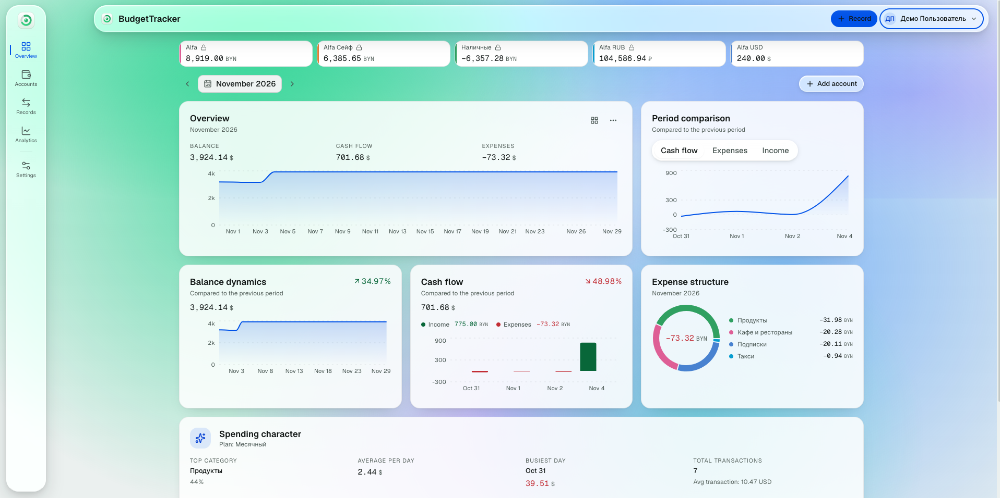

<div align="center">

# BudgetTracker

### Personal Finance Management System

[](./LICENSE)
[](https://www.python.org/)
[](https://fastapi.tiangolo.com/)
[](https://reactjs.org/)
[](https://www.typescriptlang.org/)
[](https://www.postgresql.org/)
[](https://www.docker.com/)

**Track expenses, manage multi-currency accounts, and get insights into your spending habits with advanced analytics.**

[Features](#-features) • [Quick Start](#-quick-start) • [Documentation](#-documentation) • [Deployment](#%EF%B8%8F-development) • [License](#-license)

</div>

---

## 📊 Preview

<div align="center">
  <picture>
    <source media="(prefers-color-scheme: dark)" srcset="docs/assets/dashboard-preview-dark.png">
    <source media="(prefers-color-scheme: light)" srcset="docs/assets/dashboard-preview-light.png">
    
  </picture>
</div>

<br>

## ✨ Features

### Core Functionality
- **Multi-currency accounts** with automatic conversion and personal exchange rates
- **Smart categorization** with auto-rules, category tree, tags, and record templates
- **Transfers between accounts** with real-time balance updates
- **Records management**: bulk operations, CSV import, export to CSV / TSV / JSON / XLS / PDF
- **Advanced analytics** with period comparison, trends, category breakdowns, and category × month matrix
- **Subscriptions** with charge reminders (see below)
- **Session management**: view active devices and sign out remotely
- **Admin panel** for user management
- Budget limits per category
- Fully free to use: every feature is available to everyone — no paid tiers or limits

### Crypto
- **Crypto accounts alongside regular ones** — unified balance and analytics in your base currency
- **On-chain sync of watched addresses** (read-only, public endpoints): EVM, BTC, TON, TRON, Solana, Avalanche; optional Etherscan/Moralis keys unlock richer EVM backfill
- Wallet kinds: Trust, Telegram, or manual
- **Live prices via CoinGecko**, balance history and charts

### Subscriptions & Notifications
- Track recurring charges with price, currency, and billing interval
- **Reminders via Web Push and Telegram**: 0 / 1 / 2 days before the charge, delivered at 12:00 in the user's timezone
- Localized notifications (Russian / English), one reminder per charge (no duplicates)
- Installable **PWA** with Web Push support

### Telegram Mini App
- The app **opens inside Telegram as a Mini App** — no password needed
- Auto-login via cryptographically signed `initData` (HMAC-SHA256 with the bot token); falls back to the normal login form when Telegram is not linked
- Link your Telegram account in Settings via the bot, then use the same bot for reminders

### Security & Privacy
- JWT authentication in httpOnly cookies (no localStorage)
- GitHub OAuth and email/password sign-in with email verification
- Bcrypt password hashing (work factor 12)
- Row-level isolation: all queries filtered by `user_id`
- CORS restricted to configured origins
- Rate limiting ready (TODO)

## 🚀 Quick Start

### Prerequisites
- Docker & Docker Compose
- Git

### 1. Clone the repository

```bash
git clone https://github.com/5alex52/BudgetTracker.git
cd BudgetTracker
```

### 2. Configure environment

```bash
cp .env.example .env
# Edit .env and set:
# - SECRET_KEY (minimum 32 characters)
# - POSTGRES_PASSWORD (strong password)
# - ENVIRONMENT=LOCAL (for development)
```

### 3. Start the stack

```bash
docker compose up --build
```

### 4. Access the application

| Service | URL | Description |
|---------|-----|-------------|
| Frontend | http://localhost:5173 | React SPA |
| Backend API | http://localhost:8000 | FastAPI |
| Swagger Docs | http://localhost:8000/docs | API documentation |
| Admin Panel | http://localhost:5173/admin | Superuser only |

### 5. Create demo data (optional)

```bash
# Seed demo user with 6 accounts, 25 categories, 387 transactions
docker compose exec backend python -m scripts.seed_demo

# Create admin superuser
docker compose exec backend python -m scripts.seed_admin
```

**Demo credentials:**
- User: `demo@budgettracker.local` / `demo12345`
- Admin: `admin@budgettracker.local` / `admin12345`

## 📚 Documentation

| Document | Description |
|----------|-------------|
| [AGENTS.md](./AGENTS.md) | Architecture guide for AI agents and developers |
| [API Reference](http://localhost:8000/docs) | Interactive Swagger UI (after starting the stack) |
| [Deployment Guide](./docs/DEPLOYMENT.md) | Production deployment with Ansible |
| [CI/CD Pipeline](./.github/workflows/ci.yml) | Automated testing and deployment |
| [Contributing](./CONTRIBUTING.md) | Development workflow and code style |

### Architecture Overview

```
┌─────────────────────────────────────────────────────────┐
│  Frontend (React + TypeScript + Vite)                   │
│  ├── Zustand state management                           │
│  ├── Glassmorphism UI with dark/light themes            │
│  └── i18n (Russian/English)                             │
└────────────────────┬────────────────────────────────────┘
                     │ REST API (JSON)
┌────────────────────▼────────────────────────────────────┐
│  Backend (FastAPI + SQLAlchemy + Pydantic)              │
│  ├── Layered architecture: Router → ViewSet → Service   │
│  ├── Domains: users, finance, crypto, analytics         │
│  ├── JWT auth in httpOnly cookies                       │
│  └── Redis caching with scope invalidation              │
└────────────────────┬────────────────────────────────────┘
                     │
        ┌────────────┼────────────┐
        ▼            ▼            ▼
   PostgreSQL    Redis        RabbitMQ
   (data)        (cache)      (async tasks)
```

See [AGENTS.md](./AGENTS.md) for detailed architecture documentation.

## 🛠️ Development

### Running tests

```bash
# All tests
docker compose exec backend python -m pytest tests -q

# Specific module
docker compose exec backend python -m pytest tests/finance -q

# With coverage
docker compose exec backend python -m pytest --cov=src tests
```

### Database migrations

```bash
# Apply migrations
docker compose exec backend alembic upgrade head

# Create new migration
docker compose exec backend alembic revision --autogenerate -m "description"

# Rollback one migration
docker compose exec backend alembic downgrade -1
```

### Code style

```bash
# Backend: Black formatter
docker compose exec backend black --line-length 120 src/

# Frontend: TypeScript + ESLint
cd frontend && npx tsc --noEmit
cd frontend && npx eslint src/
```

## 🚢 Deployment

### Production deployment

```bash
# Build production images
docker compose -f docker-compose.prod.yml up --build -d

# Apply migrations
docker compose -f docker-compose.prod.yml exec backend alembic upgrade head
```

### Ansible deployment

For automated deployment to remote servers, see [docs/DEPLOYMENT.md](./docs/DEPLOYMENT.md).

```bash
cd ansible
ansible-playbook -i inventory.yml deploy.yml
```

## 🔧 Configuration

### Environment variables

See [.env.example](./.env.example) for all available options.

**Critical for production:**
- `SECRET_KEY` — JWT signing (minimum 32 characters)
- `POSTGRES_PASSWORD` — Database password
- `ENVIRONMENT` — Set to `PROD` for secure cookies
- `CORS_ORIGINS` — Allowed frontend origins

**Optional integrations:**
- `TELEGRAM_BOT_TOKEN` — Telegram reminders and Mini App login (create a bot via [@BotFather](https://t.me/BotFather))
- `VAPID_PUBLIC_KEY` / `VAPID_PRIVATE_KEY` / `VAPID_SUBJECT` — Web Push (generate with `npx web-push generate-vapid-keys`)
- `OAUTH_GITHUB_CLIENT_ID` / `OAUTH_GITHUB_CLIENT_SECRET` — GitHub sign-in

**Telegram Mini App setup:** deploy the app to a public HTTPS URL, set the bot's Menu Button / Web App URL to that address in @BotFather, and link Telegram in the app's Settings. Auto-login works for linked accounts; everyone else gets the normal login form inside Telegram.

## 📖 API Examples

### Authentication

```bash
# Register
curl -X POST http://localhost:8000/api/auth/register \
  -H "Content-Type: application/json" \
  -d '{"email":"user@example.com","password":"secret123","firstname":"John","lastname":"Doe"}'

# Login
curl -X POST http://localhost:8000/api/auth/login \
  -H "Content-Type: application/x-www-form-urlencoded" \
  -d "username=user@example.com&password=secret123"
```

### Finance

```bash
# Create account
curl -X POST http://localhost:8000/api/finance/accounts \
  -H "Cookie: access_token=..." \
  -H "Content-Type: application/json" \
  -d '{"name":"Checking","type":"checking","currency":"USD","initial_balance":1000}'

# Get transactions
curl http://localhost:8000/api/finance/transactions \
  -H "Cookie: access_token=..."
```

### Analytics

```bash
# Get summary
curl "http://localhost:8000/api/analytics/summary?start_date=2026-01-01&end_date=2026-01-31" \
  -H "Cookie: access_token=..."

# Get category breakdown
curl "http://localhost:8000/api/analytics/by-category?start_date=2026-01-01&end_date=2026-01-31" \
  -H "Cookie: access_token=..."
```

## 🤖 AI Agent Support

This repository includes documentation for AI coding agents:

- **AGENTS.md** — Architecture, conventions, and development workflow

AI agents can understand the codebase structure, run tests, create migrations, and implement new features following the established patterns.

## 🔒 Security

- **No localStorage**: JWT tokens stored in httpOnly cookies
- **Password hashing**: Bcrypt with work factor 12
- **Row-level security**: All queries filtered by `user_id`
- **CORS**: Restricted to configured origins
- **Rate limiting**: Ready for implementation (TODO)

**Reporting vulnerabilities:** please use [GitHub private vulnerability reporting](https://github.com/5alex52/BudgetTracker/security/advisories/new) — do not open public issues for security problems.

## 📄 License

**Apache License 2.0 with the Commons Clause condition** — see [LICENSE](./LICENSE) for the full text.

Copyright 2026 Aleksei Kurkovskii.

- ✅ Free to use, copy, modify, and distribute — for personal projects and inside your company.
- ❌ **No selling**: the Commons Clause forbids providing the software to third parties for a fee, including paid hosting or consulting/support services whose value derives entirely or substantially from BudgetTracker's functionality.

Because of the Commons Clause, this is a *source-available* license rather than an OSI-approved open-source license.

## 🙏 Acknowledgments

- [FastAPI](https://fastapi.tiangolo.com/) — Modern web framework
- [React](https://reactjs.org/) — UI library
- [PostgreSQL](https://www.postgresql.org/) — Database
- [Redis](https://redis.io/) — Cache and session storage
- [SQLAlchemy](https://www.sqlalchemy.org/) — ORM
- [Radix UI](https://www.radix-ui.com/) — Accessible components


<div align="center">

**Built with ❤️ for personal finance management**

[Back to top](#budgettracker)

</div>
