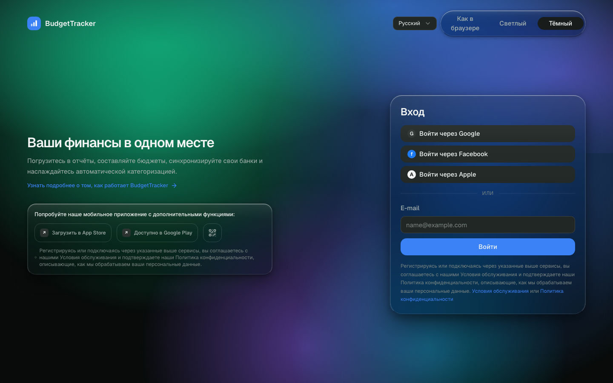
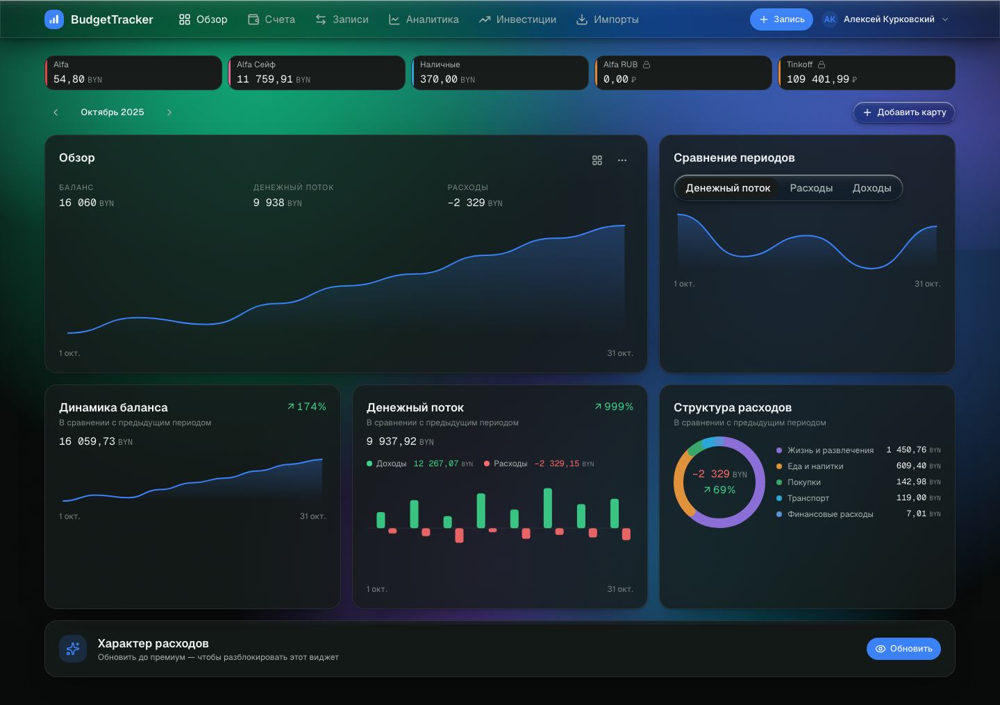
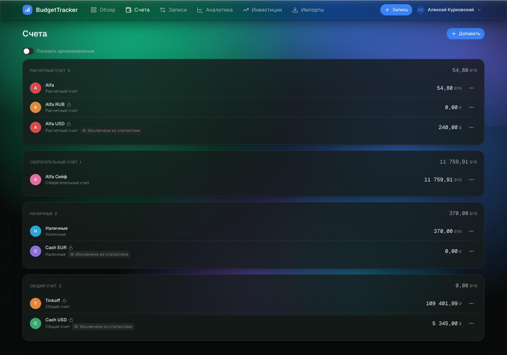
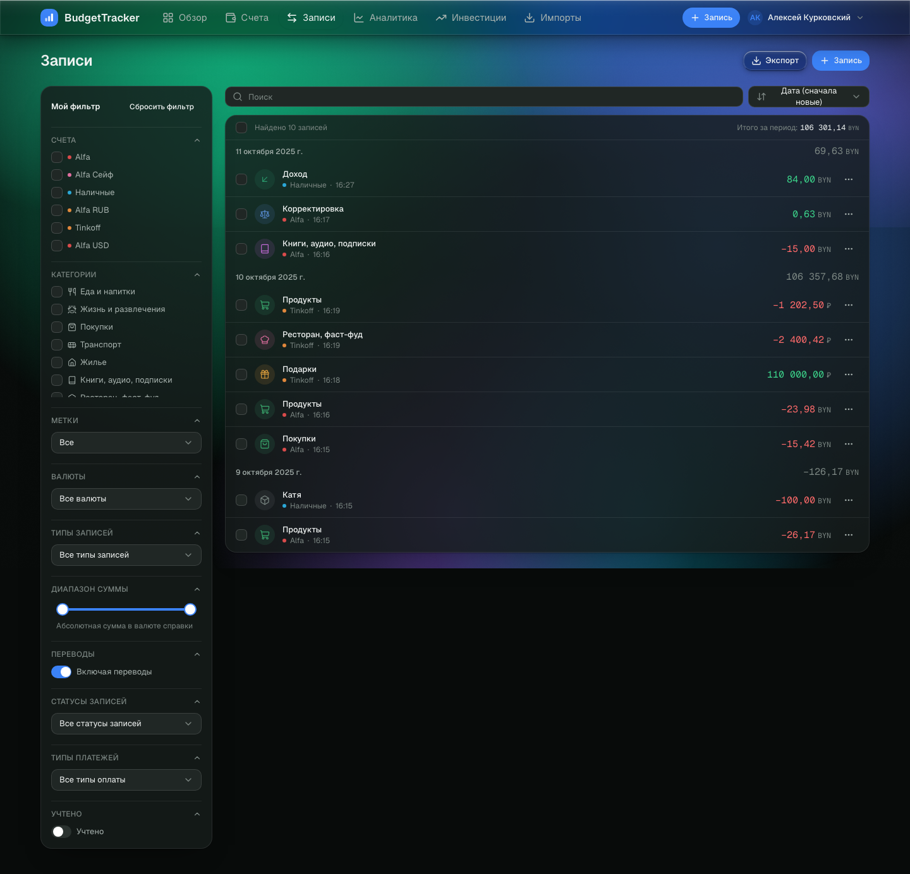
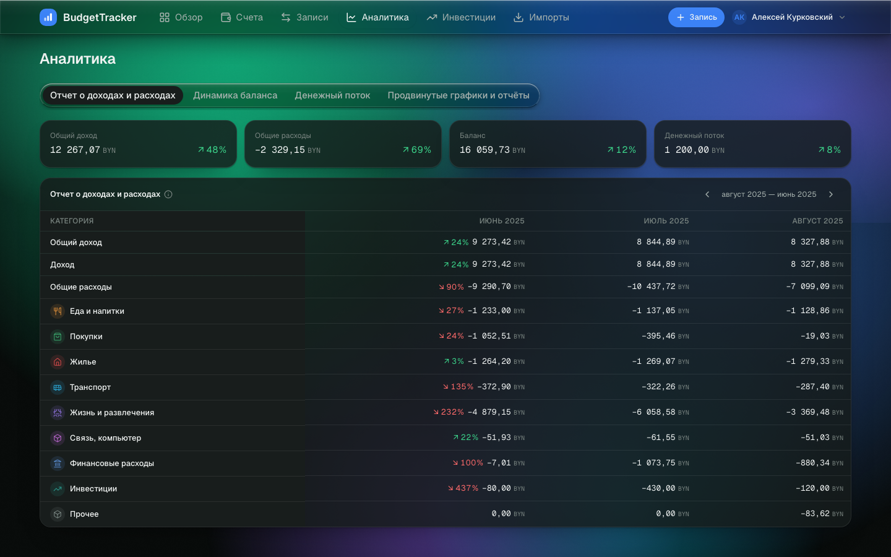
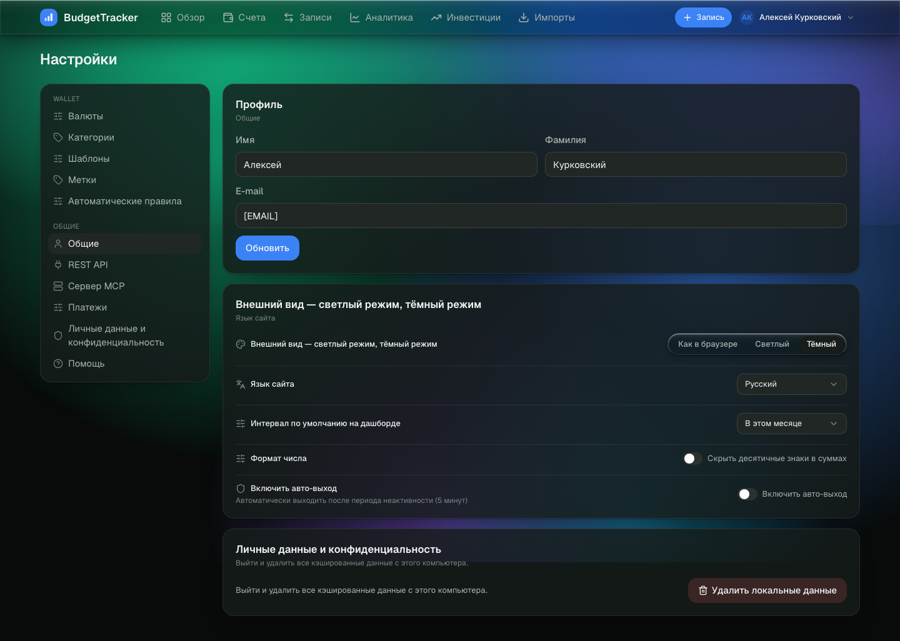
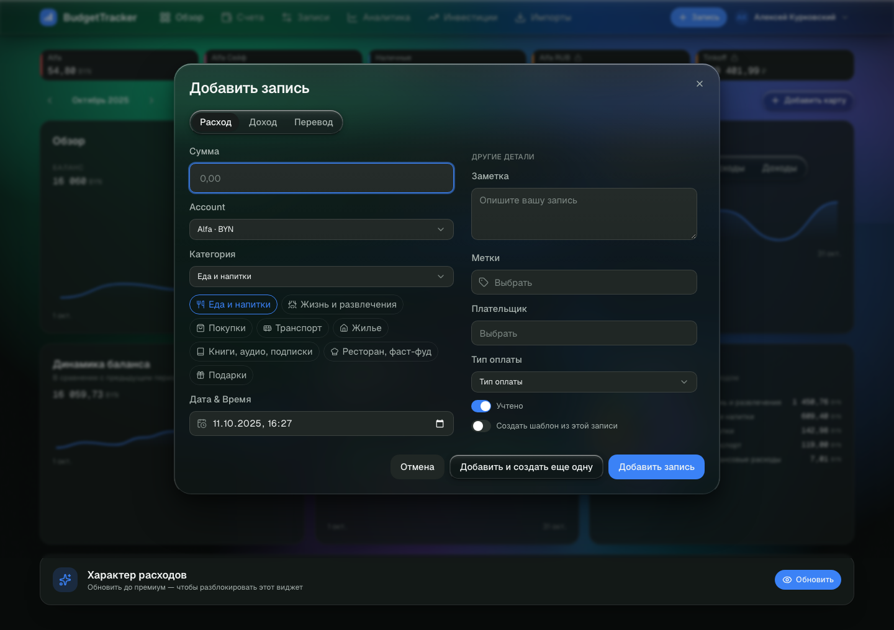
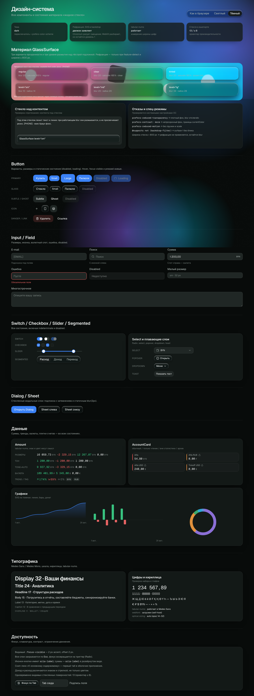

# Макеты на утверждение

Как смотреть: открыть `docs/design/mockups/index.html` в браузере (двойной клик, сервер не нужен).
Там 62 снимка: экраны, состояния, английская версия и отрисовка в WebKit; клик по картинке открывает полный размер.

Пересобрать: `bash tools/capture-mockups.sh` (Chromium), `bash tools/capture-webkit.sh` (WebKit),
`node tools/build-contact-sheet.mjs` (витрина).

Каждый экран снят в двух темах и на двух ширинах: **1440 px** (десктоп) и **390 px** (мобильный веб).
Полные страницы, не обрезанные по вьюпорту.

Парный документ: `SPEC.md` — палитра, материал, типографика, сетка, состав компонентов.

---

## 1. Окно входа (`/login`)

| Что | Решение |
|---|---|
| Композиция | Две колонки: слева промо и блок мобильного приложения, справа стеклянная карточка формы (уровень `lg`) |
| Форма | Заголовок «Вход», три внешних провайдера (нейтральные бейджи, без чужих логотипов), разделитель «или», поле e-mail, кнопка, юридический текст |
| Промо | Заголовок 32 px, подзаголовок, ссылка «Узнать подробнее», блок с бейджами магазинов и кнопкой QR |
| Мобильный вид | Колонки складываются: форма первой (order-1), промо ниже |
| Отступления | Логотипы App Store/Google Play заменены текстовыми бейджами; вместо фотографии-обложки — цветные пятна под стеклом |

---

## 2. Обзор (`/`)

| Что | Решение |
|---|---|
| Плитки счетов | 5 в ряд на десктопе, 2 на мобиле; высота 50 px, цветная полоса-маркер слева, замок у read-only счетов |
| Тулбар | Навигатор месяца «‹ Октябрь 2025 ›» + кнопка «Добавить карту» |
| Виджеты | Обзор (KPI + линия), Сравнение периодов (segmented), Динамика баланса, Денежный поток (бары), Структура расходов (донат + легенда), премиум-замок |
| Сетка | 12 колонок: широкие виджеты 7–8, узкие 4–5; на мобиле всё в одну колонку |
| Почему не как в референсе | В референсе виджеты плотно набиты мелким кеглем; здесь база 15 px и воздух — иначе стекло «зажато» |

---

## 3. Счета (`/accounts`)

| Что | Решение |
|---|---|
| Группировка | По типу счёта: расчётный, сберегательный, наличные, общий. Заголовок группы — overline 11 px + количество |
| Итог | Сумма по группе в шкале BYN, справа от заголовка |
| Строка счёта | Аватар с первой буквой в цвете счёта, название, тип, бейджи «Исключено из статистики» / «Архивировано», сумма, меню |
| Архив | Переключатель «Показать архивированные» над списком |

---

## 4. Записи (`/records`)

| Что | Решение |
|---|---|
| Слева | Панель «Мой фильтр»: 11 групп (счета, категории, метки, валюты, типы записей, диапазон суммы, переводы, статусы, типы платежей, учтённые). Каждая группа сворачивается |
| Тулбар | Поиск, сортировка (4 варианта), «Экспорт», «+ Запись» |
| Шапка списка | «Выбрать все», найдено N записей, «Итого за период» |
| Список | Группы по дням, в заголовке дня — сумма дня; строка: чекбокс, иконка категории в тоне, название, счёт + время + заметка, сумма, меню |
| Мобильный вид | Фильтры уходят в Sheet по кнопке «Мой фильтр»; чекбокс и меню строки скрыты, чтобы сумма не сжималась |

---

## 5. Аналитика (`/analytics`)

| Что | Решение |
|---|---|
| Вкладки | Отчёт о доходах и расходах · Динамика баланса · Денежный поток · Продвинутые графики |
| Итоги | Четыре плитки: общий доход, общие расходы, баланс, денежный поток — с трендом к прошлому периоду |
| Таблица | Строки — категории, колонки — три месяца; первая колонка sticky, заголовок липнет и по вертикали; тренд-бейдж только в свежем месяце |
| Мобильный вид | Вкладки прокручиваются горизонтально одной строкой; таблица — в собственном горизонтальном скролле с min-width 640 px |

---

## 6. Настройки (`/settings`)

| Что | Решение |
|---|---|
| Навигация | Две группы: WALLET (валюты, категории, шаблоны, метки, правила) и ОБЩИЕ (общие, REST API, MCP, платежи, конфиденциальность, помощь) |
| Профиль | Имя, фамилия, e-mail, кнопка «Обновить» |
| Предпочтения | Внешний вид (3 состояния), язык сайта, интервал по умолчанию, скрыть копейки, авто-выход |
| Опасное действие | «Удалить локальные данные» — кнопка `danger` + подтверждение в стеклянном диалоге |

---

## 7. Модал «Добавить запись»

| Что | Решение |
|---|---|
| Формат | Стеклянный диалог шириной до 880 px, две колонки: основное и «Другие детали» |
| Основное | Сегменты Расход/Доход/Перевод, сумма (крупный инпут), счёт, категория, быстрые плитки категорий, дата и время |
| Детали | Заметка, метки, плательщик, тип оплаты, «Учтено», «Создать шаблон» — на поверхности surface-2 без второго слоя стекла |
| Подвал | Отмена · «Добавить и создать ещё одну» · «Добавить запись» |

---

## 8. Дизайн-система (`/design`)

Витрина для приёмки: три уровня размытия × три варианта прозрачности над контрастной подложкой, все состояния кнопок, полей, переключателей, слоёв, сумм, графиков, шкала типографики и кириллица.

---

## 9. Состояния

| Снимок | Что показывает |
|---|---|
| `records-filters-mobile-dark.png` | Фильтры в Sheet на 390 px |
| `analytics-advanced-desktop-dark.png` | Премиум-вкладка с апселлом |

---

## 10. Проверка раскладки (после правок)

Проверял не на глаз, а зондом обрезанного контента (`tools/check-layout.sh`): он ищет элементы, у которых содержимое шире контейнера.

| Экран | Ширина | Было | Стало |
|---|---|---|---|
| Вход | 390 | Переполнение 611 px — переключатели темы и языка не переносились | **исправлено**: шапка переносится, пара переключателей встаёт отдельной строкой, сегменты делят ширину |
| Настройки | 390 | Строка «Внешний вид» шире карточки на 16 px | **исправлено**: контрол получает свою строку, сегменты компактнее до `sm` |
| Записи | 1440 | Панель фильтров шире на 12 px | **исправлено**: у ползунка появился горизонтальный отступ под подписи |
| Дизайн | любая | Бегунки ползунка выступают на 4–8 px | оставлено: это подписи значений, они появляются по ховеру |

Текущее состояние зонда: у всех экранов «ок». Единственное «не ок» — намеренная обрезка длинных названий счетов на дашборде (`text-overflow: ellipsis`) и собственные горизонтальные скроллы вкладок и таблицы аналитики на 390 px.

## 10.1 Кросс-браузерная проверка (WebKit)

Снимки сделаны в настоящем WebKit через `WKWebView` (`tools/webkit-shot.swift`), без Playwright.

| Что проверялось | Результат |
|---|---|
| Рендер всех экранов | Совпадает с Chromium по составу и сетке |
| `-webkit-backdrop-filter` | Работает: стекло размывает подложку (формы за панелями мягкие) |
| SVG-рефракция (`backdrop-filter: url(#…)`) | WebKit значение разбирает, но смещение не рисует. Объявление не ломает уровень 1: базовый blur остаётся, то есть откат происходит сам собой |
| Подпись на витрине | Уточнена: «движок заявляет» вместо «поддерживается», с пояснением про WebKit |

---

## 11. Что прошу утвердить

1. Композицию экранов из разделов 1–8.
2. Три осознанных отступления от референса: плотность 15 px вместо 12–13, стекло вместо плоской тёмной темы, собственный логотип и нейтральные бейджи магазинов.
3. Список дефектов из раздела 10 — правлю их сразу после «ок» или добавляю в список того, что можно оставить.

---

## 11. Вторая итерация: каркас, переводы, новые экраны

### 11.1 Что изменено в каркасе

Главная претензия к первой версии — шапка и структура слишком повторяли референс. Там это горизонтальная полоса меню на всю ширину экрана, и она самый узнаваемый элемент чужого продукта. Перестроено:

| Было (как в референсе) | Стало |
|---|---|
| Полоса меню на всю ширину со всеми разделами | **Вертикальный рельс** слева: иконка + подпись, активный пункт с полосой-индикатором, настройки внизу рельса |
| Шапка = меню + действия | **Плавающая панель-капсула** с отступами от краёв: бренд, контекст страницы, поиск, тема, «+ Запись», меню пользователя |
| «Настройки» — один длинный экран | Настройки разбиты на **подразделы с собственной навигацией**: Валюты, Категории, Шаблоны, Метки, Правила, Личные данные и конфиденциальность |
| Плоский список счетов | Карточка счёта открывает **«Детали счёта»** с вкладками «Баланс / Записи» |

Мобильный веб не изменился принципиально: рельс скрыт, навигация в стеклянном таб-баре.

### 11.2 Новые экраны

| Экран | Маршрут | Что есть |
|---|---|---|
| Валюты | `/settings/currencies` | Форма «Добавить новую валюту» (название + курс), таблица «Ваши валюты» с двусторонним курсом, базовая валюта помечена и не удаляется |
| Категории | `/settings/categories` | Слева родительские категории, справа подкатегории; модал редактирования: название, цвет, характер расходов, «Скрыть»; добавление новой подкатегории |
| Метки | `/settings/tags` | Список меток с частотой использования, добавление и удаление |
| Шаблоны | `/settings/templates` | Список шаблонов, добавление через модал |
| Автоматические правила | `/settings/rules` | Правила «когда → тогда» с переключателями включения |
| Личные данные и конфиденциальность | `/settings/privacy` | Документы, письма и сообщения (переключатель), переносимость данных, контакты |
| Детали счёта | `/accounts/:id` | Название, тип, «Баланс / Записи», остаток, сравнение с периодом, график; во вкладке «Записи» — «Найдено N записей», массовые действия, список по дням |

### 11.3 Перевод между счетами

Модал «Добавить запись» → вкладка «Перевод»:

- **Со счёта** и **На счет** — два независимых селектора, счёт-источник исключён из списка получателей;
- **Сумма \*** и **Сумма** — две суммы: в валюте источника и в валюте получателя;
- при разных валютах вторая сумма считается автоматически по курсам из справочника и её можно переписать вручную — тогда курс пересчитывается из введённых значений;
- подсказка объясняет состояние: «Счета в одной валюте — перевод без конвертации» либо «Валюты счетов различаются — сумма и курс пересчитываются · Курс 1 RUB = 0,0354 BYN»;
- поля категории нет — категория к переводу не относится;
- обязательное поле суммы больше не подсвечивается красным при простом переключении вкладок (было ложное срабатывание).

### 11.4 Исправленные дефекты второй итерации

| Что | Симптом | Исправление |
|---|---|---|
| Выпадающие списки | Пропала стеклянная подложка: меню сливалось со страницей | При переходе на общий `glassClass()` класс потерялся у контента оверлеев — вернули, проверили вычисленным стилем (`rgba(16,22,21,.5)` + `blur(10px)`) |
| Валюты на 390 | Таблица распирала страницу | Компактные отступы, действия — иконками, курс одной строкой |

---

## 12. Третья итерация: правки по замечаниям

| # | Замечание | Что сделано | Где |
|---|---|---|---|
| 1 | Экспорт — выпадающее меню с форматами | Меню «Экспорт»: CSV (`;`), TSV, Excel (`.xls`, SpreadsheetML), JSON, PDF (через печать). CSV/TSV пишутся с BOM — Excel не ломает кириллицу; файлы скачиваются на клиенте, бэкенд не нужен | `src/__shared__/utils/export-records.ts`, `Records` |
| 2 | Редактирование записи не готово | Модал работает в двух режимах: создание и правка. Правка открывается из меню строки (и в деталях счёта), поля предзаполнены, заголовок «Редактировать запись», кнопка «Сохранить». Появилось общее состояние записей: создание, правка и удаление сразу видны на всех экранах | `src/store/records.ts`, `AddRecordDialog` |
| 3 | Не показываются вложенные категории | Селект категории стал сгруппированным: заголовок родителя + подкатегории с отступом и цветной точкой. Под плитками родителей появился второй ряд подкатегорий выбранной категории | `FilterSelect` (группы), `AddRecordDialog` |
| 4 | Красный акцент для расхода, зелёный для дохода | Акцент следует за типом: полоса сверху модала, цвет суммы, кнопка подтверждения. Расход — красный, доход — зелёный, перевод — синий | `AddRecordDialog` |
| 5 | Переключатель месяцев с диапазоном дат | Вместо стрелок только по месяцам — `PeriodPicker`: стрелки, кнопка периода и календарь диапазона. Библиотека — **`react-day-picker`** (стандарт для shadcn/Radix: режим диапазона, локали, доступность), плюс пресеты «Сегодня / Этот месяц / Прошлый месяц / 3 месяца / Этот год». Есть на «Обзоре» и в «Аналитике» | `src/components/data/PeriodPicker.tsx` |
| 6 | Убрать «Импорты» и «Инвестиции» | Удалены из рельса и таб-бара; пункты остались только как ключи словаря | `SideRail`, `nav-items` |
| 7 | Окно редактирования валюты | Карандаш в таблице открывает окно: название, код, курс к базовой валюте, удаление. Базовая валюта не редактируется по курсу | `SettingsCurrencies` |
| 8 | Убрать MCP и API из настроек | Пункты «REST API» и «Сервер MCP» удалены из навигации настроек | `SettingsLayout` |
| 9 | Отрисовать вкладку «Платежи» | Новый экран: текущий план, автопродление, способы оплаты (основная карта, удаление, «сделать основной»), история списаний, форма добавления карты | `src/__pages__/SettingsPayments` |
| 10 | Убрать упоминание мобильного приложения на логине | Удалён блок с магазинами приложений и QR-кодом. Осталась только строка о правовых документах | `Login` |
| 11 | Убрать поиск в шапке | Поле поиска из верхней панели удалено; поиск остался там, где он нужен — на странице «Записи» | `TopBar` |
| 12 | Интерактивные графики | Ручной SVG заменён на **recharts**: подсказки с точными значениями при наведении, подсветка точки, курсор. Оформление на наших токенах, API компонентов не менялся. Ось Y получила компактные подписи (`18k`, `4,5k`), чтобы значения не обрезались | `src/components/charts/charts.tsx` |
| 13 | «Добавить не карту, а счёт» | Подпись кнопки на «Обзоре» — «Добавить счёт» (была «Добавить карту») | словари, `Dashboard` |

### 12.1 Проверки третьей итерации

- Интерактивность графиков проверена событием наведения: подсказка отдаёт «14 окт. · 14 120».
- Меню экспорта: пунктов пять, форматы перечислены в порядке CSV, TSV, Excel, JSON, PDF.
- Акценты проверены вычисленным стилем: расход — `rgb(255,107,107)`, доход — `rgb(61,214,140)`.
- Правка записи: заголовок «Редактировать запись», поля предзаполнены (счёт, категория, сумма).
- Календарь открывается на месяце данных (октябрь 2025), пресеты на месте.
- Раскладка: зонд по 17 маршрутам, на 390 и 1440 — без новых переполнений. Проба больше не считает ложные срабатывания по SVG-тексту графиков.
- `tsc`, `eslint --max-warnings 0`, `vite build` — чисто.

---

## 13. Четвёртая итерация: логотип, счета, аудит кнопок

### 13.1 Логотип

Взят из `docs/design/Logo Dark.svg` и `Logo Light.svg` без перерисовки: тёмная версия — плитка с неоновой линией роста, светлая — белая плитка с мягкой тенью. Оба варианта встроены в компонент `Logo` как SVG, переключение между ними — на CSS (`dark:hidden` / `hidden dark:block`), поэтому знак меняется вместе с темой, включая `?theme=` в адресе.

Где стоит: рельс навигации (36 px вместо прежней плашки «BT»), шапка-капсула рядом с названием, окно входа. Фавикон — те же файлы с медиазапросом `prefers-color-scheme`.

### 13.2 Счета: создание и правка

Одна форма на два режима — `AccountDialog`:

- создание: «Новый счёт», пустые поля, кнопка «Добавить»;
- правка: «Редактировать счёт», подзаголовок с именем счёта, кнопка «Сохранить», слева — «Удалить».

Поля: название, валюта, тип (расчётный / сберегательный / наличные / общий), баланс, цвет-маркер, три переключателя — «исключить из статистики», «архив», «только чтение». Именно эти состояния в референсе показаны иконками в списке, но не редактируются — форма закрывает пробел.

Открывается отовсюду: «Добавить счёт» на «Обзоре» и на «Счетах», пункты «Редактировать»/«Удалить» в меню строки, «Редактировать» на экране деталей счёта. Счета переехали в общее состояние, поэтому новый счёт сразу виден на «Обзоре», в списке и в статистике.

Удаление — через подтверждение: «Удалить счёт?» с пояснением, что записи остаются в истории.

### 13.3 Аудит кнопок

Добавлен инструмент `tools/audit-buttons.mjs`: обходит 14 экранов, для каждой кнопки делает настоящий клик мышью через CDP и сравнивает состояние до и после (открылся слой, сменился адрес, изменился текст, переехал активный пункт, появился тост). Кнопки, после которых не меняется ничего, попадают в отчёт.

Первый прогон: **68 мёртвых из 159**. Последний прогон: **0**.

Что починил:

| Кнопка | Было | Стало |
|---|---|---|
| «+ Запись» в шапке | работала только на «Обзоре» и «Записях» | обработчик в контексте, работает на всех экранах |
| Стрелки месяца на «Обзоре» | декоративные | сдвигают месяц: подпись меняется на «Сентябрь 2025 г.» |
| «Сравнение периодов» | значение зашито | переключатель меняет ряд на графике |
| «Добавить счёт» | ничего | форма счёта |
| «Настроить виджет», «Ещё» | ничего | меню: состав KPI, переходы в аналитику и записи |
| «Обновить» (премиум) | ничего | диалог с возможностями и переходом к тарифам |
| Пункты меню строки счёта | ничего | детали, правка, удаление |
| Кнопки входа | ничего | демонстрационный вход на «Обзор» |
| «Редактировать» у шаблона | ничего | форма правки (название + что подставляет) |
| «Добавить правило» | была disabled | форма правила: условие, категория |
| «Сменить план» | ничего | выбор тарифа из трёх |
| «Скачать копию данных» | ничего | выгрузка JSON со счетами, записями, метками, правилами |
| «Сотрудник по защите данных» | ничего | окно с составом запроса и адресом |
| «Сбросить фильтр» | сбрасывал невидимо | сбрасывает и подтверждает тостом |
| «Подробнее о фильтрах» | только по наведению | поповер по клику |

Отдельно нашлась настоящая причина «мёртвой» кнопки «Обновить» в настройках: поле e-mail содержало заглушку без `@`, браузерная валидация блокировала отправку формы, и нажатие молча ничего не делало. Адрес заменён на корректный демонстрационный.

### 13.4 Проверки

- Аудит: 14 экранов, 159 кнопок, 0 без реакции.
- Создание счёта: диалог → «Добавить» → тост «Счёт создан», счёт появляется на «Обзоре».
- Правка: меню строки → «Редактировать» → «Редактировать счёт», поля предзаполнены (`Alfa`, 3 переключателя).
- Удаление: подтверждение → тост «Счёт удалён» → возврат на `/accounts`.
- Диалоги тарифа (3 варианта), шаблона (2 поля с данными), правил, ДПО — открываются, поля на месте.
- Английский: «New account», «Checking account / Savings account / Cash / General account», «Exclude from statistics».
- 390 px: форма счёта складывается в столбик, тип переносится, кнопки в одну строку.
- Раскладка: зонд по 22 проверкам — переполнений документа нет, все срабатывания — `truncate` с многоточием.
- `tsc`, `eslint --max-warnings 0`, `vite build` — чисто.

---

## 14. Пятая итерация: контраст текста

### 14.1 Инструмент

Добавлен `tools/check-contrast.mjs`: проходит 14 экранов и проверяет читаемость по WCAG 2.1.

- Для каждого видимого текста берёт `color` и фактический фон: идёт по предкам и послойно смешивает полупрозрачные подложки (стекло, поверхности, подсветки) с базовым фоном темы.
- Отдельно меряет плейсхолдеры полей, подписи внутри SVG (оси и легенды графиков — у них цвет задаётся заливкой, а не `color`) и иконки.
- Пороги: 4.5:1 для обычного текста, 3:1 для крупного и для графики (WCAG 1.4.11).
- Проверяет не только сами экраны, но и открытые слои: диалоги записи и счёта, меню экспорта, тарифы, обращение к ДПО.

Первый прогон, тёмная тема: **44 провала из 740**. Светлая тема: 18 (после первой правки третичного текста). Сейчас: **0 из 1652** в обеих темах.

### 14.2 Что было не так

| Проблема | Было | Стало |
|---|---|---|
| Белый текст на акцентной кнопке | `#3b82f6` давал 3.35:1 — «Запись», «Обновить», «Добавить карту» читались хуже нормы | отдельный токен заливки `--accent-fill` (#2563eb): 4.6:1, а сам `--accent` остался светлым для ссылок и текста |
| Акцентный текст на мягкой подложке | тёмно-синий на синей подложке — 4.22:1 (аватар «АК») | токен `--accent-on-soft`: в тёмной теме светлый #93c5fd, в светлой — тёмный #1d4ed8 |
| Третичный текст в тёмной теме | #7c8783 на панели давал 4.1:1 | #8b9691 |
| Третичный текст в светлой теме | #77837f на белом — 3.87:1, на панели 3.58:1: подписи полей, категории, валюты | #5f6b66 |
| Положительные суммы и бейджи в светлой теме | #0f8a52 на белом 4.32:1, на зелёной плашке 3.71:1 | #0a7042 (5.1:1 на плашке) |
| Буквы на цветных плашках счетов | белый на светлых оттенках давал 2.7–3.0:1 | функция `chipColors()` подбирает цвет буквы, а если не хватает — затемняет оттенок шагами |
| Кнопки «Добавить запись» в расходе и доходе | белый на `#ff6b6b` — 2.53:1 | токены `--negative-fill` (#c23f3f) и `--positive-fill` (#157f4f) плюс явный белый текст |
| Значки категорий на плашках своего оттенка | 2.0–2.9:1 — иконка сливалась с подложкой, особенно в светлой теме | `readableOnTint()` сдвигает оттенок до 3:1 под текущую тему |
| Бейдж Facebook на входе | белый на #1877F2 — 4.23:1 | #1557b0 |
| Подписи осей графиков | цвет брался из несуществующей переменной `--fg-tertiary`, recharts рисовал их дефолтным серым | переменные приведены к настоящим (`--text-secondary`), заодно починены `--stroke-subtle` и `--bg-1` |

Попутно проверено, что в коде не осталось ссылок на несуществующие CSS-переменные: из пяти найденных три оказались легитимными (задаются в рантайме или имеют значение по умолчанию).

### 14.3 Проверки

- Тёмная тема: 0 провалов из 1652 измерений (текст, плейсхолдеры, SVG-подписи, иконки), включая открытые диалоги и меню.
- Светлая тема: те же 0.
- Подписи осей: измерено 60 штук, минимум 8.25:1.
- Глазами: скриншоты `v5-contrast-*` — буквы в плашках счетов читаются, кнопки не потеряли вид, иерархия «основной / вторичный / третичный» сохранилась.
- `tsc`, `eslint --max-warnings 0`, `vite build` — чисто.

### 14.4 Календарь диапазона в тёмной теме

Библиотека `react-day-picker` приходит со своими переменными: выбранный день — чистый синий (`blue`), полоса диапазона — почти белый `#f0f0ff`. В тёмной теме это выглядело как светлая заплата на стекле, и выделение не совпадало с остальной палитрой.

Класс `rdp-glass` раньше был пустой заглушкой — теперь он переводит все переменные библиотеки на наши токены:

| Элемент | Было | Стало |
|---|---|---|
| Крайние даты диапазона | чистый `blue` с белой цифрой | заливка `--accent-fill` (#2563eb), белая цифра — 4.6:1; лишняя рамка у краёв убрана |
| Полоса между датами | почти белый `#f0f0ff` | `--accent-soft`: в тёмной теме 18 % акцента, в светлой 12 % |
| Сегодняшняя дата | `blue` | акцентный текст темы |
| Дни соседних месяцев | прозрачность 50 % — цифры проваливались | приглушены цветом `--text-tertiary` при полной непрозрачности, остаются читаемыми |
| Дни недели, подписи месяцев | системный шрифт и цвет | `--text-tertiary` и `--text-primary`, размеры 11 и 13 px |
| Сетка | ячейки 44 px | 34 px — календарь стал компактнее и не спорит с плотностью интерфейса |
| Навигация по месяцам | крупные стрелки | 28 px, цвет `--text-secondary`, подсветка при наведении |

Попутно нашлась ошибка раскладки: на 390 px поповер с двумя месяцами выходил за экран (522 px при ширине 390). Теперь на узких экранах календарь показывает один месяц, а поповер ограничен `max-w-[calc(100vw-1.5rem)]` — 366 px, без горизонтальной прокрутки.

Проверка: календарь добавлен в аудит контраста (открывается в разделе `/ → «Выбрать период»`) — 0 провалов в обеих темах, всего 1813 измерений.
